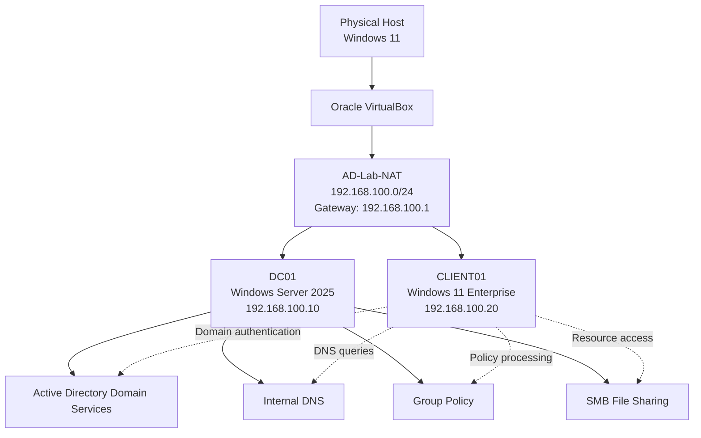
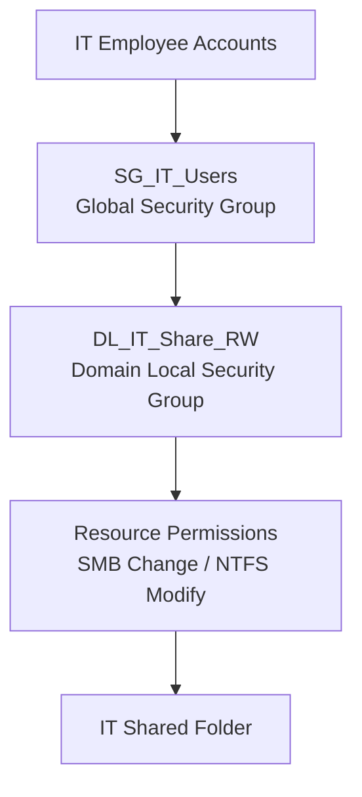

# Windows Server & Active Directory Lab


## Overview

A hands-on enterprise infrastructure lab focused on deploying, configuring, administering, automating, and troubleshooting a Windows Server Active Directory environment.

The project simulates a small corporate IT infrastructure, including centralized identity management, domain-joined workstations, organizational units, security groups, Group Policy, departmental file sharing, and PowerShell automation.

Each lab follows a structured workflow:

**Learn → Build → Test → Document → GitHub**

This project is part of my IT Infrastructure Portfolio, focused on developing practical system administration, networking, automation, and infrastructure troubleshooting skills.

## Project Objectives

- Deploy and configure Windows Server 2025.
- Establish an Active Directory domain and internal DNS infrastructure.
- Centralize user, computer, and security group management.
- Join a Windows workstation to the domain.
- Implement centralized configuration through Group Policy.
- Configure secure departmental file sharing using SMB and NTFS permissions.
- Implement role-based resource access using AGDLP.
- Automate administrative reporting with PowerShell.
- Diagnose and resolve common Active Directory infrastructure issues.
- Validate Domain Controller health and essential services.

## Infrastructure Architecture



## Environment

| Component | Configuration |
|---|---|
| Hypervisor | Oracle VirtualBox |
| Host OS | Windows 11 Home |
| Server OS | Windows Server 2025 Standard Evaluation |
| Client OS | Windows 11 Enterprise Evaluation |
| Domain Controller | DC01 |
| Workstation | CLIENT01 |
| Active Directory Domain | `corp.example.test` |
| NetBIOS Domain Name | `CORP` |
| Virtual Network | AD-Lab-NAT |
| Network Address | 192.168.100.0/24 |
| Default Gateway | 192.168.100.1 |
| Domain Controller IP | 192.168.100.10 |
| Workstation IP | 192.168.100.20 |
| Internal DNS Server | 192.168.100.10 |
| Address Assignment | Static IPv4 |

## Technologies and Tools

| Category | Technologies |
|---|---|
| Server Administration | Windows Server 2025 |
| Identity Management | Active Directory Domain Services |
| Network Services | DNS, LDAP, Kerberos |
| Centralized Configuration | Group Policy |
| Resource Sharing | SMB, NTFS |
| Access Management | Security Groups, AGDLP |
| Automation | PowerShell, ActiveDirectory Module |
| Virtualization | Oracle VirtualBox |
| Diagnostics | DCDiag, NLTest, GPResult, KList |
| Development | Visual Studio Code |
| Version Control | Git, GitHub |

## Active Directory Structure

A departmental directory structure was implemented to separate users, security groups, and managed workstations.

```text
corp.example.test
│
├── Departments
│   ├── IT
│   │   ├── Marco Rossi
│   │   └── Luca Ferrari
│   ├── HR
│   │   └── Giulia Bianchi
│   └── Sales
│       └── Alessandro Verdi
│
├── Groups
│   ├── SG_IT_Users
│   ├── SG_HR_Users
│   ├── SG_Sales_Users
│   └── DL_IT_Share_RW
│
├── Workstations
│   └── CLIENT01
│
└── Domain Controllers
    └── DC01
```

## Group Policy Implementation

Two custom Group Policy Objects were implemented and tested.

| Group Policy Object | Target | Configuration |
|---|---|---|
| GPO_Workstation_Baseline | Workstations OU | Enable Windows Defender Firewall on the Domain profile |
| GPO_IT_User_Restrictions | IT OU | Prevent desktop background changes |

Policy application was verified using:

- Group Policy Management.
- `gpupdate /force`.
- `gpresult`.
- Windows Firewall configuration inspection.
- Functional testing with users from different departments.

## Role-Based Resource Access

Departmental file sharing was implemented using the AGDLP access management model.

**Accounts → Global Groups → Domain Local Groups → Permissions**



### Shared Resource Configuration

| Property | Configuration |
|---|---|
| Share Name | IT |
| Local Path | `C:\Shares\IT` |
| Network Path | `\\DC01\IT` |
| Authorized Group | CORP\DL_IT_Share_RW |
| SMB Permission | Change |
| NTFS Permission | Modify |
| Administrative Access | Full Control |

### Authorization Testing

| User | Department | Expected Access | Result |
|---|---|---|---|
| Marco Rossi | IT | Allowed | PASS |
| Luca Ferrari | IT | Allowed | PASS |
| Giulia Bianchi | HR | Denied | PASS |
| Alessandro Verdi | Sales | Denied | PASS |

Access was managed through security group membership rather than assigning permissions directly to individual employee accounts.

## Completed Labs

| Lab | Description | Status |
|---|---|---|
| [00 — Environment Setup](labs/00-environment-setup/README.md) | Virtualization, resource planning, and virtual network preparation | Completed |
| [01 — Windows Server Installation](labs/01-windows-server-installation/README.md) | Server installation and initial system configuration | Completed |
| [02 — Active Directory Deployment](labs/02-active-directory-deployment/README.md) | AD DS installation, Domain Controller promotion, and DNS validation | Completed |
| [03 — AD Users & Groups](labs/03-ad-users-groups/README.md) | Organizational units, user accounts, and security groups | Completed |
| [04 — Domain Join](labs/04-domain-join/README.md) | Workstation domain integration and authentication testing | Completed |
| [05 — Group Policy](labs/05-group-policy/README.md) | Centralized user and computer configuration | Completed |
| [06 — File Sharing](labs/06-file-sharing/README.md) | SMB shares, NTFS permissions, and AGDLP | Completed |
| [07 — AD PowerShell Administration](labs/07-ad-powershell/README.md) | Administrative automation and user lifecycle management | Completed |
| [08 — AD Troubleshooting & Recovery](labs/08-ad-troubleshooting/README.md) | Controlled infrastructure incidents and Domain Controller health validation | Completed |

## PowerShell Automation

The project includes a reusable Active Directory user audit script.

### Get-ADUserAuditReport.ps1

[View Script](labs/07-ad-powershell/scripts/Get-ADUserAuditReport.ps1)

The script retrieves employee accounts from the departmental OU structure and exports their administrative information to a CSV report.

### Features

- Dynamic domain distinguished name discovery.
- OU-scoped Active Directory queries.
- Configurable report output directory.
- Automatic directory creation.
- CSV report generation.
- Structured error handling.
- User count reporting.
- Non-zero exit code on failure.

### Usage

Run from an environment with access to Active Directory and the required PowerShell module.

Default report directory:

```powershell
.\Get-ADUserAuditReport.ps1
```

Custom report directory:

```powershell
.\Get-ADUserAuditReport.ps1 -ReportsDirectory "C:\ADLab\reports-test"
```

### Exported Properties

- Name
- SamAccountName
- Department
- Title
- Enabled

### Script Validation

| Test | Result |
|---|---|
| Default report generation | PASS |
| Custom output directory | PASS |
| Automatic directory creation | PASS |
| CSV data validation | PASS |
| Write-protected destination handling | PASS |
| Failure exit code verification | PASS |

Generated reports are excluded from version control.

## Troubleshooting and Recovery

Four controlled infrastructure faults were introduced, diagnosed, and resolved.

A final preventive infrastructure health audit was also performed.

| Incident | Root Cause | Resolution | Result |
|---|---|---|---|
| Internal DNS resolution failure | Incorrect DNS server configuration | Restored internal DNS | RESOLVED |
| Domain Controller connectivity failure | Disabled network adapter | Re-enabled Ethernet adapter | RESOLVED |
| Departmental share access failure | Missing security group membership | Restored group membership and refreshed security context | RESOLVED |
| Group Policy application failure | Disabled GPO link | Re-enabled link and refreshed policy | RESOLVED |
| Infrastructure health audit | Preventive validation | No repairs required | PASS |

### Troubleshooting Methodology

1. Establish a healthy baseline.
2. Reproduce the reported issue.
3. Collect diagnostic information.
4. Identify the root cause.
5. Implement a targeted solution.
6. Verify restored functionality.
7. Document the incident.

Unexpected diagnostic observations were documented without making unsupported assumptions about their underlying causes.

## Final Infrastructure Validation

| Validation | Result |
|---|---|
| Windows Server deployment | PASS |
| Active Directory domain deployment | PASS |
| Internal DNS resolution | PASS |
| Active Directory service discovery | PASS |
| Workstation domain join | PASS |
| Domain authentication | PASS |
| User account lifecycle management | PASS |
| Security group management | PASS |
| Computer Group Policy application | PASS |
| User Group Policy application | PASS |
| SMB and NTFS authorization | PASS |
| Unauthorized resource access prevention | PASS |
| PowerShell audit automation | PASS |
| Controlled incident recovery | PASS |
| Essential Domain Controller services | PASS |
| SYSVOL and NETLOGON share presence | PASS |
| DCDiag diagnostics | No errors reported |

All nine planned labs were completed.

## Skills Demonstrated

### Windows Server Administration

- Server installation and configuration.
- Static IPv4 configuration.
- Windows service management.
- Server role deployment.
- Infrastructure health validation.

### Active Directory Administration

- Domain Controller deployment.
- Active Directory DNS integration.
- Organizational unit management.
- User and computer account management.
- Security group management.
- User onboarding and account lifecycle management.
- Domain authentication and service discovery.

### Security and Access Management

- Authentication and authorization.
- Role-based access management.
- Global and Domain Local security groups.
- AGDLP implementation.
- SMB and NTFS permissions.
- Access-token inspection.
- Positive and negative authorization testing.

### Group Policy Administration

- GPO creation and configuration.
- OU-based policy targeting.
- User and computer policies.
- Policy inheritance and application.
- GPO troubleshooting and validation.

### PowerShell Automation

- Active Directory cmdlets.
- Object filtering and property selection.
- Hashtable splatting.
- Parameterized scripts.
- Dynamic configuration discovery.
- CSV report generation.
- Error handling and exit codes.
- Safe administrative previews using `-WhatIf`.

### Infrastructure Troubleshooting

- Network connectivity diagnosis.
- Internal DNS troubleshooting.
- Domain Controller discovery.
- Secure-channel diagnostics.
- Security group authorization troubleshooting.
- Group Policy troubleshooting.
- Domain Controller health checks.
- Evidence-based root cause analysis.

### Professional Workflow

- Technical documentation.
- Controlled configuration changes.
- Functional validation.
- Feature branch development.
- Meaningful Git commits.
- Pull requests and branch cleanup.

## Repository Structure

```text
06-Windows-Server-Active-Directory/
│
├── README.md
├── .gitignore
│
└── labs/
    ├── 00-environment-setup/
    │   └── README.md
    │
    ├── 01-windows-server-installation/
    │   └── README.md
    │
    ├── 02-active-directory-deployment/
    │   └── README.md
    │
    ├── 03-ad-users-groups/
    │   └── README.md
    │
    ├── 04-domain-join/
    │   └── README.md
    │
    ├── 05-group-policy/
    │   └── README.md
    │
    ├── 06-file-sharing/
    │   └── README.md
    │
    ├── 07-ad-powershell/
    │   ├── README.md
    │   └── scripts/
    │       └── Get-ADUserAuditReport.ps1
    │
    └── 08-ad-troubleshooting/
        └── README.md
```

## Scope and Limitations

This project represents a controlled learning environment rather than a production-ready enterprise deployment.

The infrastructure consists of one Domain Controller and one domain-joined workstation.

The following areas were outside the project scope:

- Multi-Domain Controller redundancy.
- Multi-site Active Directory replication.
- Additional domains and forest trusts.
- Computer account trust repair.
- Active Directory Certificate Services.
- Enterprise backup and disaster recovery.
- Production-grade security hardening.
- Hybrid identity and Microsoft Entra ID integration.

Infrastructure recovery exercises focused on restoring functionality following controlled configuration and connectivity failures.

## Future Improvements

Potential extensions to this environment include:

- Deploying a secondary Domain Controller.
- Configuring Active Directory replication and redundancy.
- Implementing DHCP.
- Expanding administrative delegation.
- Automating bulk user provisioning.
- Implementing centralized infrastructure monitoring.
- Configuring backup and restoration procedures.
- Applying advanced security baselines.
- Exploring hybrid identity management.

## Portfolio Roadmap

| Project | Focus | Status |
|---|---|---|
| 01 — IT Home Lab | System inspection | Completed |
| 02 — Windows Troubleshooting Lab | Problem diagnosis | Completed |
| 03 — Windows System Administration Lab | System management | Completed |
| 04 — PowerShell Automation Toolkit | Automation and scripting | Completed |
| 05 — Networking Fundamentals Lab | Networking | Completed |
| 06 — Windows Server & Active Directory | Enterprise administration | Completed |
| 07 — Linux Administration Lab | Linux administration | Planned |
| 08 — Infrastructure Monitoring Lab | Monitoring and observability | Planned |
| 09 — Cloud Infrastructure Lab | Cloud administration | Planned |
| 10 — Infrastructure as Code & CI/CD | Infrastructure automation | Planned |

## Conclusion

This project demonstrates the deployment and administration of a functional Windows Server Active Directory environment, from initial infrastructure preparation to centralized identity management, resource authorization, automation, and troubleshooting.

The completed labs provide practical experience with core enterprise system administration responsibilities and establish a foundation for further infrastructure, Linux, cloud, and DevOps projects.

---

**Project 06 of 10 — IT Infrastructure Portfolio**
